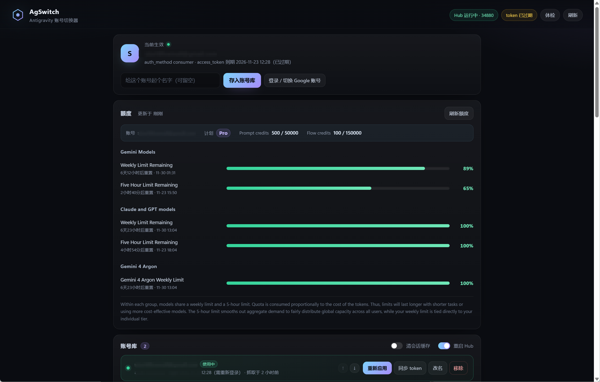

# AgSwitch · Antigravity 账号切换器

> Windows 上的 [Antigravity](https://antigravity.google) 多账号切换 + 额度看板。
> 一个窗口，点一下就换号，不用再「退出登录 → 浏览器选账号 → 等回调 → 授权」。

**纯 Python 标准库，零第三方依赖**。账号库用 Windows DPAPI 加密。



---

## 它解决什么问题

Antigravity 的登录态绑死在 `language_server.exe` 进程里，换号要全套重走 OAuth。
而这个"登录态"本质只有**一条 Windows 凭据**，所以完全可以把它存起来、一键换回去。

顺带把额度也做了：剩余百分比、重置倒计时、按模型组分类，数据来自 language server
自己的本地 API（服务端权威值，不是估算）。

## 功能

| 功能 | 说明 |
|---|---|
| **账号切换** | 存多个账号，点一下就换；自动重启 Antigravity 让它重新读凭据 |
| **额度看板** | 各模型组的周额度 / 5 小时额度剩余比例 + 重置时间 + Pro/Ultra 计划与 credits |
| **Google 登录** | 调 language server 的登录链路，登出后可拿 `auth_url` 换号 |
| **邮箱错位检测** | 凭据身份与 Hub 本地标记不一致时告警，一键同步 |
| **环境自检** | WSL 报错诊断、启动隐患（`ELECTRON_RUN_AS_NODE`）、凭据体检、日志清理 |
| **会话缓存清理** | 换号后仍闪旧账号时，清 Hub 内嵌浏览器的 Cookie / LocalStorage（先备份） |

## 快速开始

### 方式 A：下载 exe（无需 Python）

到 [Releases](https://github.com/uSerUq0312/AgSwitch/releases) 下载 `AgSwitch.exe`，双击即可。
单文件、9 MB，Python 已打包进去。

> 因为是个人构建、没有代码签名，第一次运行 Windows 可能弹 SmartScreen 提示
> （"更多信息 → 仍要运行"）。作者自己的构建产物 SHA-256 会写在 Release 说明里。

### 方式 B：从源码跑

```powershell
git clone https://github.com/uSerUq0312/AgSwitch.git
cd AgSwitch
python app\main.py          # 需要 Python 3.10+，零第三方依赖
```

或者直接双击 `start-agswitch.cmd`。

**首次使用**：

```
① 正常开着 Antigravity，用账号 A 登录
② 启动 AgSwitch → 点「存入账号库」
③ 在 Antigravity 里退出登录，用账号 B 登录 → 再点一次「存入账号库」
④ 以后点哪一行的「切换」就换到哪个账号
```

## 打包成 exe

```powershell
pip install pyinstaller
python build_exe.py --desktop   # 产物 dist/AgSwitch.exe，--desktop 会顺手拷到桌面
```

---

## 底层原理（全部实测，language_server 2.34.0 / Hub 2.34.0）

### 1. 身份本体只有一条 Windows 凭据

```
TargetName : gemini:antigravity
UserName   : antigravity
Type       : CRED_TYPE_GENERIC (1)
Persist    : CRED_PERSIST_LOCAL_MACHINE (2)
Blob       : UTF-8 JSON
```

```json
{
  "token": {
    "access_token":  "ya29....",
    "token_type":    "Bearer",
    "refresh_token": "1//0e...",
    "expiry":        "2026-11-21T05:15:14.0537836Z",
    "expires_in":    3599
  },
  "auth_method": "consumer",
  "id_token_email": "you@gmail.com",
  "writer_id": "C3o8..."
}
```

`language_server.exe` 启动时 `CredRead` 这条记录，进程内用 `refresh_token` 续期，
续完 `CredWrite` 写回同一条。所以：

> **换掉这条 blob = 换掉账号；换完必须重启 language server，让它重新读一次。**

### 2. 界面上的邮箱 = Hub 的本地标记（会错位！）

```
%APPDATA%\Antigravity\app_storage.json
    agy.onboarding.lastLoginUsername
    agy.onboarding.lastLoginIsGcpTos
%APPDATA%\Antigravity\credential-user-scope     (udc...)
```

这个小写目录 `%APPDATA%\antigravity\` 也要一起写。

> **坑**：`id_token_email` 才是权威身份，`app_storage` 里的是"上次登录时写下的"，
> 换号后不会自动更新。实测遇到过凭据已经是 `A@gmail.com`、界面却还显示 `B@gmail.com`。
> 本工具的邮箱优先级：`id_token_email` > `app_storage` > token 内解析，
> 不一致时顶部弹告警 + 一键同步。

### 3. 切换时到底改了哪些字节

```
写 token       →  凭据管理器 gemini:antigravity
写邮箱标记     →  app_storage.json × 2 份
写作用域       →  credential-user-scope
可选清缓存     →  Partitions\hub-browser-*\Network\Cookies、Local Storage、Session Storage
重启           →  Antigravity.exe → 重新拉起 language_server.exe
```

**写回必须保留结构、只替换身份**。早期版本只写自己认识的字段，把 `id_token_email`
冲成空串；后来又改成"无条件继承旧 id_token_email"，导致切到 B 时名牌还挂在 A 身上。
现在两者都有回归测试（`tests/switch_roundtrip.py`）。

### 4. 为什么不能离线续 token

内置的三个 client_id 全是 Desktop 类型，refresh 必须带 `client_secret`：

```
HTTP 400  invalid_request  "client_secret is missing."
```

而这个 secret **不落盘、不进环境变量**（`tools/probe_client_secret.py` 扫过整个
`%APPDATA%` / `%LOCALAPPDATA%`，只找到二进制里的残片，实测全部 `invalid_client`）。

所以工具**不伪造刷新**：切号照常生效，access_token 过期也没关系 —— Antigravity
启动时自己会续；续不上才需要重新登录。

### 5. 额度从哪来

language server 自己起了一个本地 HTTP 服务：

```
POST http://127.0.0.1:<httpPort>/exa.language_server_pb.LanguageServerService/<Method>
Header: X-Codeium-Csrf-Token: <csrf>
```

端口与 csrf 在 `~/.gemini/antigravity/daemon/hub_<httpPort>.json`。

| 方法 | 返回 |
|---|---|
| `RetrieveUserQuotaSummary` | 各模型组周额度 / 5 小时额度剩余比例 + 重置时间 |
| `GetUserStatus` | 邮箱、计划名、prompt/flow credits |
| `GetAuthStatus` | 是否已登录、已授权 scope（毫秒级） |
| `Login` / `AuthLogout` / `GetLoginSession` | 登录 / 登出 / 授权地址 |

返回结构：

```json
{"response":{"groups":[
  {"displayName":"Gemini Models","buckets":[
    {"bucketId":"gemini-weekly","window":"weekly",
     "remainingFraction":0.13065761,"resetTime":"2026-11-28T08:53:15Z"},
    {"bucketId":"gemini-5h","window":"5h","remainingFraction":1}
  ]}
]}}
```

> **为什么不自己拿 token 直连 Google 后端**：实测新 token 打
> `cloudcode-pa/v1internal:retrieveUserQuotaSummary` 返回
> `403 You do not have a valid license of this product` —— LS 调用时会附带额外授权头。
> 所以额度走本地 API；LS 不在时会明确提示"先启动 Antigravity"，不显示假数据。

### 6. Gemini 登录的两个实测行为

- 已登录时 `Login` **也会**跑完内部校验，**40~60 秒**才返回 `hasValidAuth=true`。
  所以先打毫秒级的 `GetAuthStatus` 挡住白等。
- 真未登录时才给 `auth_url`，可在弹窗里直接复制。

### 7. WSL 报错（无害，但有办法根治）

日志里反复出现的：

```
[error] Failed to list WSL distros: Error: wsl.exe --list --verbose failed
[error] wsl:get-state failed: Error: wsl.exe --list --verbose failed
```

根因在 `app.asar` 的 `dist/wsl.js`：

```js
exports.WSL_EXE = path.join(process.env.SystemRoot || 'C:\\Windows',
                            'System32', 'wsl.exe');
```

没装 WSL 时它就是占位程序，每次启动固定抛 **4 处**错。**不影响任何功能。**

试过但行不通：

| 方案 | 结果 |
|---|---|
| PATH 前置假 `wsl.exe` | 无效 —— 用的是绝对路径，PATH 不参与 |
| 改 `SystemRoot` 指向假根 | 危险 —— Electron 起不来 |
| 在 System32 放垫片 | 要管理员，且污染系统目录 |

根治（管理员）：

```powershell
wsl.exe --install --no-distribution
```

只装 WSL 运行组件、不装发行版，约 100MB。装完重启一次即彻底消失。
不想装也行：工具里「环境自检 → 清理历史日志」能把已产生的报错块剥离（实测 1418 行 → 454 行）。

### 8. 启动隐患：ELECTRON_RUN_AS_NODE

排查 WSL 问题时发现一个更致命的坑：环境里若带着

```
ELECTRON_RUN_AS_NODE=1
```

Antigravity 会以 **Node 模式**启动然后秒退，表现像"程序坏了"，日志都不更新。

> `Antigravity.exe --version` 会打印 `v24.22.0` —— 那是 Node 的版本号，不是 Antigravity 的。
> 看到这个就能确定中招了。

工具的入口和启动器都会主动清掉这个变量。

## 安全设计

- 账号库 `accounts.dat` 用 **DPAPI（CurrentUser）整体加密**，换机器 / 换用户都解不开；
- 每次写盘滚动备份，保留最近 10 份；
- HTTP 后端只监听 `127.0.0.1` + 系统分配端口，所有 `/api/*` 需要一次性 token
  （放在 URL fragment，不进 Referer / 服务端日志）；
- 清会话缓存前一律挪到 `cache-backups\<时间戳>\`，可还原；
- 只操作 `Antigravity.exe`，不碰 t3code / codex / 其它 Electron 应用。

## 项目结构

```
app/
├── main.py                 入口（起后端 + 开窗口）
├── core/
│   ├── identity.py         身份层：凭据 ←→ 账号、邮箱标记、会话缓存
│   ├── wincred.py          Windows 凭据管理器 CredRead/CredWrite/CredDelete
│   ├── lsapi.py            language server 本地 API（额度 / 账号 / 登录）
│   ├── store.py            DPAPI 加密账号库
│   ├── oauth.py            token 解析 + 可选带 secret 的刷新
│   ├── procs.py            进程识别 / 优雅重启 Hub 与 IDE
│   ├── wslfix.py           WSL 报错诊断与日志清理
│   ├── service.py          业务编排
│   ├── api.py              HTTP API（127.0.0.1 + token 鉴权）
│   ├── paths.py            源码 / PyInstaller 双模式路径解析
│   ├── shell_window.py     Edge/Chrome --app 独立窗口
│   └── bridge.py           可选：WebView2 原生窗口
└── web/                    界面（无构建、无依赖）
```

## 测试

```powershell
python tests\smoke.py              # 后端全链路
python tests\switch_roundtrip.py   # 切换闭环 + 字段保留回归（自动还原）
python tests\test_launcher.py      # .cmd 启动器（含编码检查）
python tests\test_wsl.py           # WSL 诊断与日志清理（幂等）
python tests\test_lsapi.py         # LS API 直连（需 Antigravity 在跑）
```

> `.cmd` 启动器是**纯 ASCII** 的。cmd.exe 按系统 ANSI（中文系统 GBK）读批处理，
> 里面只要有一个 UTF-8 中文字符就可能被解错字节、把后面的行切碎，
> 报 `'ity' 不是内部或外部命令`。中文输出一律交给 Python。

## 已知限制

- 只支持 Windows（依赖 DPAPI + 凭据管理器）；
- 额度面板依赖 Antigravity 正在运行；
- 凭据里的 `expiry` 可能停在很久以前（LS 用内存态续期、不回写），
  此时会提示"token 已过期"但额度照常可用 —— 正常现象；
- 窗口用系统 Edge 的 `--app` 模式，装了 pythonnet + WebView2 会优先用原生窗口。

## License

MIT
